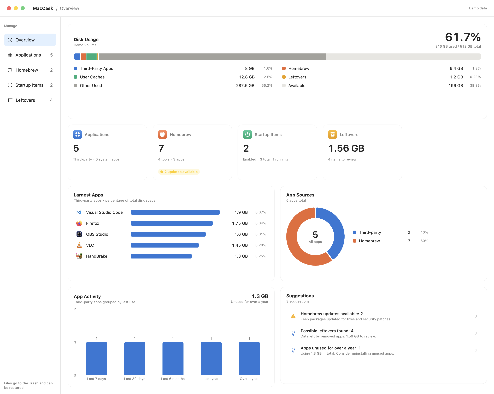
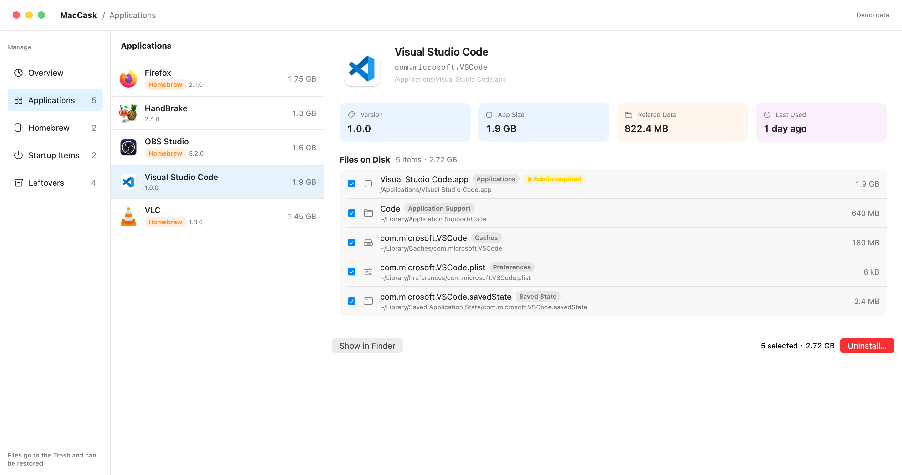
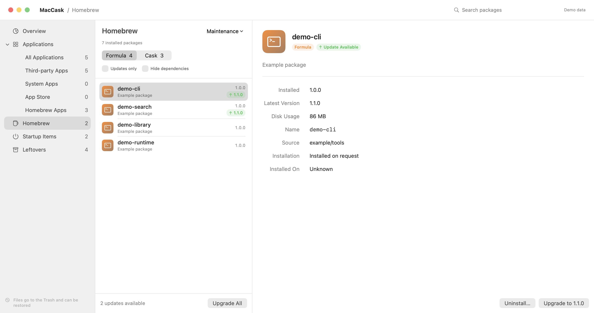
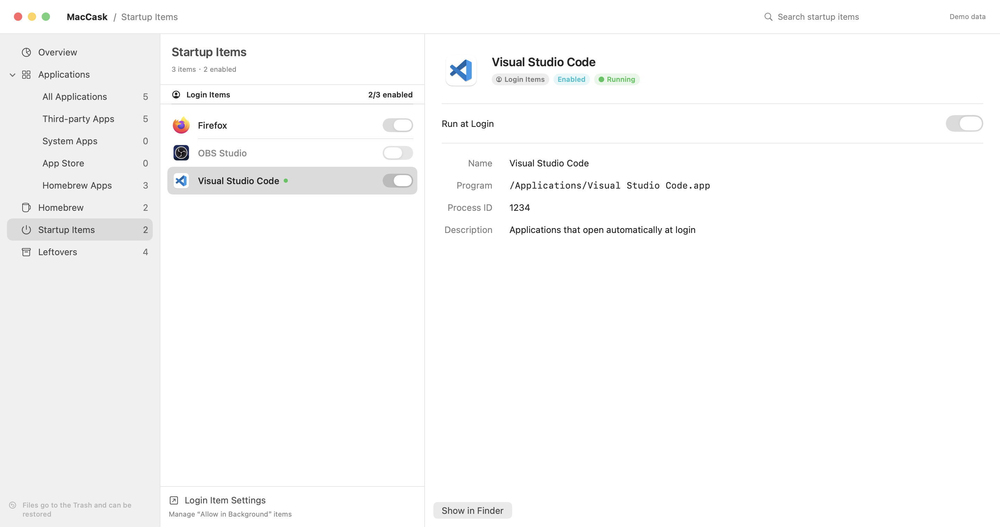
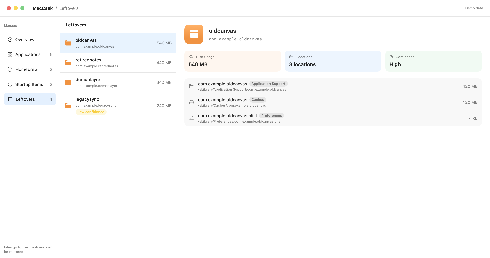

# MacCask

A native macOS application manager built with SwiftUI. Inspect installed apps and their disk usage, manage Homebrew packages and startup items, and review files left behind by removed apps.

[简体中文](docs/README.zh-CN.md) · [Build from source](#build-from-source) · [Usage](#usage) · [Contributing](#contributing) · [MIT License](LICENSE)



*Screenshots use demo data.*

## Features

- **Overview:** disk usage, largest apps, app sources, usage activity, and cleanup suggestions.
- **Applications:** search, filter, and sort installed apps; inspect versions, sizes, and related Library files; select files to remove. System apps are labeled and protected from uninstalling.
- **Homebrew:** manage Formula and Cask packages, filter dependencies and outdated packages, upgrade, uninstall, update metadata, and clean up old versions and caches. Commands display live output.
- **Startup items:** inspect and enable or disable login items, user/global agents, and third-party system daemons.
- **Leftovers:** review possible leftovers by identifier, location, size, and confidence; ignore entries or move selected files to the Trash.
- **Native interface:** light/dark appearance, sidebar navigation, list-and-detail views, and an optional menu bar entry.
- **Languages:** English and Simplified Chinese, with a saved preference and system-language matching by default.

## App updates

Use **MacCask → Check for Updates…**, or enable automatic checks in Settings. Updates use signed, architecture-specific DMGs from GitHub Releases. Versions without the updater require one manual installation first.

## Requirements

| Requirement | Details |
| --- | --- |
| Operating system | macOS 15 or later |
| Swift | Swift 6 toolchain; the package uses Swift 5 language mode |
| Packaging tools | Full Xcode 26 or later, selected as the active developer directory, for the Icon Composer assets and `actool` |
| Homebrew | Optional; needed only to manage Homebrew packages |

The project uses Swift Package Manager and Apple's frameworks, with Sparkle for in-app updates. A normal build targets the architecture of the Mac doing the build; the Makefile does not produce a universal binary.

## Build from source

### 1. Configure Xcode

Install Xcode 26 or later and open it once to complete its initial setup. Check the selected toolchain:

```sh
xcode-select --print-path
xcodebuild -version
xcrun swift --version
xcrun --find actool
```

If the selected directory points to Command Line Tools or a different Xcode installation, select your full Xcode installation. For Xcode installed at the standard location:

```sh
sudo xcode-select --switch /Applications/Xcode.app/Contents/Developer
```

### 2. Clone the repository

```sh
git clone https://github.com/MacCask/MacCask.git
cd MacCask
```

Run the following commands from this repository's root directory.

### 3. Build and launch the app

```sh
make app
open build/MacCask.app
```

`make app` builds the icons, compiles the release executable, copies its resources, creates `build/MacCask.app`, and signs the bundle. `make` runs the same default target. To build and launch in one step:

```sh
make run
```

### 4. Install to Applications

```sh
make install
open /Applications/MacCask.app
```

`make install` rebuilds the app and replaces an existing `/Applications/MacCask.app`. You can also copy `build/MacCask.app` into Applications using Finder.

### Code signing

The current MacCask app is signed with a self-signed certificate and is not notarized by Apple. macOS may show a security warning when you open it for the first time.

The Makefile uses the first available code-signing identity in your keychain. If none is found, it uses ad-hoc signing. To select an existing self-signed identity:

```sh
security find-identity -v -p codesigning
make app SIGN_IDENTITY="Your Code Signing Identity"
```

To explicitly use ad-hoc signing:

```sh
make app SIGN_IDENTITY=""
```

The app version is read from [VERSION](VERSION), initially `1.0.0`. Edit that file to change the version. You can set the build number separately:

```sh
make app BUILD=1
```

Packaging signs the app locally; it does not submit it for notarization. To verify the generated bundle:

```sh
codesign --verify --deep --strict build/MacCask.app
```

## Development

Build and run a debug executable without creating an `.app` bundle:

```sh
swift build
swift run MacCask
```

Run the automated tests:

```sh
swift test
```

| Command | Result |
| --- | --- |
| `swift build` | Debug executable and resources under `.build/` |
| `swift run MacCask` | Build and launch the debug executable |
| `swift test` | Run automated tests |
| `make build` | Build icons and the release executable |
| `make app` | Create and sign `build/MacCask.app` |
| `make release ARCH=arm64` | Build an arm64 DMG installer under `build/releases/` (use `ARCH=x86_64` for Intel) |
| `make run` | Package and launch the app |
| `make install` | Package and install to `/Applications` |
| `make clean` | Delete generated `build/` and `.build/` directories |

For everyday use and permission setup, launch the packaged `.app` from Applications.

## Usage

1. Open **Overview** to review disk usage and jump to the relevant management screen.
2. In **Applications**, select an app, inspect its related files, and choose what to remove before confirming an uninstall.
3. In **Homebrew**, switch between Formula and Cask, review updates, and follow operations in the command log.
4. In **Startup Items**, inspect the executable and source before changing its enabled state. Use **Login Item Settings** for background items managed by macOS.
5. In **Leftovers**, review the file paths and confidence. Ignore entries you want to keep or move selected entries to the Trash.

### Language and menu bar

Open **MacCask → Settings…** (`⌘,`) and select **System Default**, **English**, or **简体中文**. Changes take effect immediately and are saved. System Default follows the system's preferred supported language, falling back to English when none is supported. App names, file paths, package descriptions, and external command output retain their original text.

Use **View → Show Menu Bar Icon** to show or hide the menu bar entry. With it enabled, closing the main window keeps MacCask running; reopen it from the menu bar. With it hidden, closing the last window quits the app.

### Permissions

| Permission | Used for |
| --- | --- |
| Full Disk Access | Inspecting protected Library directories; without access, scan results may be incomplete |
| Automation → System Events | Reading and managing login items |
| Administrator authorization | Modifying protected files or system daemons when needed |

Grant permissions in **System Settings → Privacy & Security** as needed. Restart MacCask after granting Full Disk Access.

### Cleanup behavior

Regular app and leftover cleanup moves selected files to the Trash, where they can be restored until the Trash is emptied. Homebrew-managed apps and packages use Homebrew uninstall commands. Those commands, including Cask `zap` cleanup, do not provide the same Trash recovery behavior.

Quit a running application before uninstalling it. Leftover detection uses identifier matching; inspect proposed files, especially low-confidence matches that may be shared with another installed app.

## Screenshots

### Applications and related files



### Homebrew packages



### Startup items



### Leftover review



## Troubleshooting

| Problem | What to check |
| --- | --- |
| `xcodebuild` requires Xcode, or `actool` cannot be found | Check `xcode-select --print-path` and select full Xcode as described above |
| Icon Composer assets fail to compile | Run `xcodebuild -version` and confirm the selected Xcode is version 26 or later |
| Swift tools version error | Run `xcrun swift --version` and confirm the selected toolchain supports Swift 6 |
| Code-signing identity cannot be found | List identities with `security find-identity -v -p codesigning`; specify an available name or use `SIGN_IDENTITY=""` |
| Homebrew is not detected | MacCask checks `/opt/homebrew/bin/brew` and `/usr/local/bin/brew`; custom install paths are currently unsupported |
| Some related files or leftovers are missing | Check Full Disk Access and restart the packaged app after granting it |
| Login items cannot be read | Allow MacCask to control System Events under Privacy & Security → Automation |
| Installation fails with a permission error | Copy the built app to Applications in Finder and authorize the copy if macOS requests it |

For a bug report, include your macOS and Xcode versions, how you launched MacCask, reproduction steps, and relevant error output. Remove personal paths and other private information from shared logs or screenshots.

## Contributing

Bug reports, improvements, and translations are welcome through [issues](https://github.com/MacCask/MacCask/issues) and [pull requests](https://github.com/MacCask/MacCask/pulls).

For code changes, follow the [development guidelines](agents.md), run `swift test`, and verify `make app`. Check both English and Simplified Chinese for interface changes. Include a description of the change and how it was verified in your pull request.

Architecture details are in the [design document](docs/design.md).

Maintainers can configure [tag-based releases and signing secrets](docs/releasing.md). A matching version tag publishes separate Intel and Apple Silicon DMG installers after both builds succeed.

## License

MacCask is licensed under the [MIT License](LICENSE). Third-party documentation icons retain their original rights; see [icon attributions](Scripts/Documentation/Icons/README.md).
